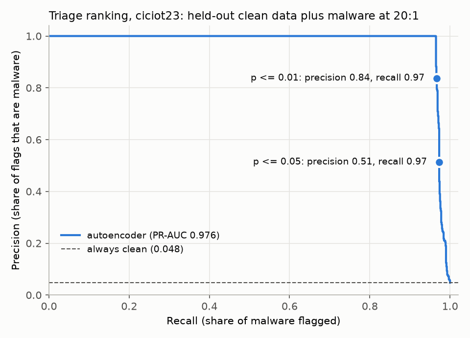

# Triage report: ciciot23

Generated by `src/triage_report.py ciciot23`. Full ranked list: `ciciot23_ranked.csv` (it also has `error_reasons`, the largest reconstruction errors); precision-recall curve: `ciciot23_pr_curve.png`.

## Summary

- Seized batch: 21,000 artefacts: 20,000 held-out clean, 1,000 malware (20:1, the base paper's ratio)
- Model: base-paper autoencoder on 39 scaled features, trained on 60,000 clean rows (seed 42); p-values from 20,000 held-out clean rows
- Flagged at p <= 0.01: 1,155: 967 malware, 188 clean (false-alarm rate 0.94%; recall 0.967; precision 0.837)
- Flagged at p <= 0.05: 1,896: 973 malware, 923 clean
- PR-AUC: 0.976 (always clean: 0.048)
- Explanations: SHAP reasons for the 1,155 flagged artefacts (per feature); the largest SHAP reason is also the largest reconstruction error for 3% of them

## The 25 most unusual artefacts

`label` and `family` are ground truth, shown for evaluation only.

| rank | artefact | score | p_value | flagged | shap_reasons | label | family |
|---|---|---|---|---|---|---|---|
| 1 | Merged01.csv:338614 | 6.3e+04 | 0.0000 | True | Number 100 vs clean median 10 (91%); rst_count 100 vs clean median 0 (6%); fin_count 100 vs clean median 0 (3%) | malware | DDOS-RSTFINFLOOD |
| 2 | Merged01.csv:78227 | 6.3e+04 | 0.0000 | True | Number 100 vs clean median 10 (91%); rst_count 100 vs clean median 0 (6%); fin_count 100 vs clean median 0 (3%) | malware | DDOS-RSTFINFLOOD |
| 3 | Merged01.csv:468470 | 6.3e+04 | 0.0000 | True | Number 100 vs clean median 10 (91%); rst_count 100 vs clean median 0 (6%); fin_count 100 vs clean median 0 (3%) | malware | DDOS-RSTFINFLOOD |
| 4 | Merged01.csv:313837 | 6.3e+04 | 0.0000 | True | Number 100 vs clean median 10 (91%); rst_count 100 vs clean median 0 (6%); fin_count 100 vs clean median 0 (3%) | malware | DDOS-RSTFINFLOOD |
| 5 | Merged01.csv:267916 | 6.3e+04 | 0.0000 | True | Number 100 vs clean median 10 (91%); rst_count 100 vs clean median 0 (6%); fin_count 100 vs clean median 0 (3%) | malware | DDOS-RSTFINFLOOD |
| 6 | Merged01.csv:263345 | 6.3e+04 | 0.0000 | True | Number 100 vs clean median 10 (91%); rst_count 100 vs clean median 0 (6%); fin_count 100 vs clean median 0 (3%) | malware | DDOS-RSTFINFLOOD |
| 7 | Merged01.csv:630359 | 6.3e+04 | 0.0000 | True | Number 100 vs clean median 10 (91%); rst_count 100 vs clean median 0 (6%); fin_count 100 vs clean median 0 (3%) | malware | DDOS-RSTFINFLOOD |
| 8 | Merged01.csv:62408 | 6.29e+04 | 0.0000 | True | Number 100 vs clean median 10 (91%); rst_count 100 vs clean median 0 (6%); fin_count 100 vs clean median 0 (3%) | malware | DDOS-RSTFINFLOOD |
| 9 | Merged01.csv:575802 | 6.29e+04 | 0.0000 | True | Number 100 vs clean median 10 (91%); rst_count 100 vs clean median 0 (6%); fin_count 100 vs clean median 0 (3%) | malware | DDOS-RSTFINFLOOD |
| 10 | Merged01.csv:32998 | 6.29e+04 | 0.0000 | True | Number 100 vs clean median 10 (91%); rst_count 100 vs clean median 0 (6%); fin_count 100 vs clean median 0 (3%) | malware | DDOS-RSTFINFLOOD |
| 11 | Merged01.csv:167681 | 6.29e+04 | 0.0000 | True | Number 100 vs clean median 10 (91%); rst_count 100 vs clean median 0 (6%); fin_count 100 vs clean median 0 (3%) | malware | DDOS-RSTFINFLOOD |
| 12 | Merged01.csv:256723 | 6.29e+04 | 0.0000 | True | Number 100 vs clean median 10 (91%); rst_count 100 vs clean median 0 (6%); fin_count 100 vs clean median 0 (3%) | malware | DDOS-RSTFINFLOOD |
| 13 | Merged01.csv:248850 | 6.29e+04 | 0.0000 | True | Number 100 vs clean median 10 (91%); rst_count 99 vs clean median 0 (6%); fin_count 100 vs clean median 0 (3%) | malware | DDOS-RSTFINFLOOD |
| 14 | Merged01.csv:40596 | 6.29e+04 | 0.0000 | True | Number 100 vs clean median 10 (91%); rst_count 100 vs clean median 0 (6%); fin_count 100 vs clean median 0 (3%) | malware | DDOS-RSTFINFLOOD |
| 15 | Merged01.csv:289050 | 6.29e+04 | 0.0000 | True | Number 100 vs clean median 10 (91%); rst_count 100 vs clean median 0 (6%); fin_count 100 vs clean median 0 (3%) | malware | DDOS-RSTFINFLOOD |
| 16 | Merged01.csv:59587 | 6.29e+04 | 0.0000 | True | Number 100 vs clean median 10 (91%); rst_count 100 vs clean median 0 (6%); fin_count 100 vs clean median 0 (3%) | malware | DDOS-RSTFINFLOOD |
| 17 | Merged01.csv:217624 | 6.29e+04 | 0.0000 | True | Number 100 vs clean median 10 (91%); rst_count 100 vs clean median 0 (6%); fin_count 100 vs clean median 0 (3%) | malware | DDOS-RSTFINFLOOD |
| 18 | Merged01.csv:421800 | 6.29e+04 | 0.0000 | True | Number 100 vs clean median 10 (91%); rst_count 100 vs clean median 0 (6%); fin_count 100 vs clean median 0 (3%) | malware | DDOS-RSTFINFLOOD |
| 19 | Merged01.csv:490821 | 6.29e+04 | 0.0000 | True | Number 100 vs clean median 10 (91%); rst_count 100 vs clean median 0 (6%); fin_count 100 vs clean median 0 (3%) | malware | DDOS-RSTFINFLOOD |
| 20 | Merged01.csv:195031 | 6.29e+04 | 0.0000 | True | Number 100 vs clean median 10 (91%); rst_count 100 vs clean median 0 (6%); fin_count 100 vs clean median 0 (3%) | malware | DDOS-RSTFINFLOOD |
| 21 | Merged01.csv:160132 | 6.29e+04 | 0.0000 | True | Number 100 vs clean median 10 (91%); rst_count 100 vs clean median 0 (6%); fin_count 100 vs clean median 0 (3%) | malware | DDOS-RSTFINFLOOD |
| 22 | Merged01.csv:114919 | 6.29e+04 | 0.0000 | True | Number 100 vs clean median 10 (91%); rst_count 100 vs clean median 0 (6%); fin_count 100 vs clean median 0 (3%) | malware | DDOS-RSTFINFLOOD |
| 23 | Merged01.csv:19835 | 6.29e+04 | 0.0000 | True | Number 100 vs clean median 10 (91%); rst_count 100 vs clean median 0 (6%); fin_count 100 vs clean median 0 (3%) | malware | DDOS-RSTFINFLOOD |
| 24 | Merged01.csv:244689 | 6.29e+04 | 0.0000 | True | Number 100 vs clean median 10 (91%); rst_count 100 vs clean median 0 (6%); fin_count 100 vs clean median 0 (3%) | malware | DDOS-RSTFINFLOOD |
| 25 | Merged01.csv:65220 | 6.29e+04 | 0.0000 | True | Number 100 vs clean median 10 (91%); rst_count 99 vs clean median 0 (6%); fin_count 99 vs clean median 0 (3%) | malware | DDOS-RSTFINFLOOD |

## Known limitations

- CICIoT2023 rows are fixed-size packet windows, not artefacts: 100 packets for floods and 10 for all other traffic, so window-dependent features (Number, Tot sum, IAT, Variance, Rate) partly encode the label.
- More than half of the released rows (53.5% across the 63 merged files) exactly repeat an earlier row, mostly DDoS floods (results/audit/ciciot23.json).
- Recall is dominated by floods, which make up most of the attack rows; spoofing, scanning and web attacks are mostly missed (per-class recall in results/heldout/ciciot23.json).
- The model learns clean data only, so it flags anything unusual, not only malware: new but legitimate software, unusual configurations and rare user activity are flagged too.
- The p-value holds only while new clean data resembles the calibration data. On BODMAS, clean files first seen up to seven months after the training period kept the false-alarm rate at about 1% (results/heldout/bodmas_temporal.json), but no longer horizon has been tested.
- shap_reasons say which features made the score high, not why the artefact is malicious. The SHAP audit (results/shap/) found that where the dataset has a capture shortcut, the reasons name it: svcscan features on MalMem, the packet-window size Number on CICIoT2023. Such a reason describes how the evidence was recorded, not malware behaviour.
- error_reasons (the largest per-feature reconstruction errors) often disagree with shap_reasons: a feature whose value is ordinary can still show a large error when one extreme feature throws off the whole reconstruction.
- Ground truth columns are included only to evaluate the ranking; they are not available at seizure.
