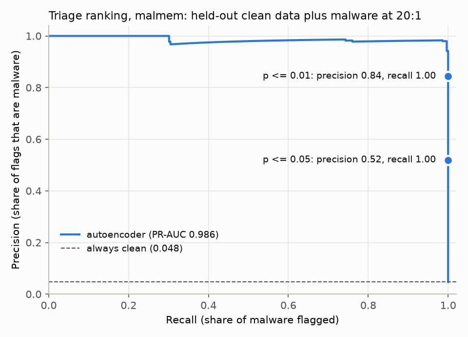

# Triage report: malmem

Generated by `src/triage_report.py malmem`. Full ranked list: `malmem_ranked.csv` (it also has `error_reasons`, the largest reconstruction errors); precision-recall curve: `malmem_pr_curve.png`.

## Summary

- Seized batch: 6,139 artefacts: 5,847 held-out clean, 292 malware (20:1, the base paper's ratio)
- Model: base-paper autoencoder on 55 scaled features, trained on 17,538 clean rows (seed 42); p-values from 5,846 held-out clean rows
- Flagged at p <= 0.01: 346: 292 malware, 54 clean (false-alarm rate 0.92%; recall 1.000; precision 0.844)
- Flagged at p <= 0.05: 562: 292 malware, 270 clean
- PR-AUC: 0.986 (always clean: 0.048)
- Explanations: SHAP reasons for the 346 flagged artefacts (per feature); the largest SHAP reason is also the largest reconstruction error for 16% of them

## The 25 most unusual artefacts

`label` and `family` are ground truth, shown for evaluation only.

| rank | artefact | score | p_value | flagged | shap_reasons | label | family |
|---|---|---|---|---|---|---|---|
| 1 | 53407 | 1.81e+05 | 0.0002 | True | malfind.commitCharge 67572 vs clean median 5 (100%); svcscan.shared_process_services 116 vs clean median 118 (0%); svcscan.kernel_drivers 221 vs clean median 222 (0%) | malware | Trojan-Zeus |
| 2 | 29444 | 2.98e+04 | 0.0002 | True | malfind.commitCharge 28153 vs clean median 5 (99%); svcscan.shared_process_services 116 vs clean median 118 (0%); psxview.not_in_ethread_pool_false_avg 0.440476 vs clean median 0.0135062 (0%) | malware | Ransomware-Ako |
| 3 | 34789 | 2.1e+04 | 0.0002 | True | malfind.commitCharge 23993 vs clean median 5 (100%); svcscan.shared_process_services 116 vs clean median 118 (0%); svcscan.kernel_drivers 221 vs clean median 222 (0%) | malware | Ransomware-Pysa |
| 4 | 44433 | 1.36e+04 | 0.0002 | True | malfind.commitCharge 19071 vs clean median 5 (99%); svcscan.shared_process_services 116 vs clean median 118 (0%); svcscan.kernel_drivers 221 vs clean median 222 (0%) | malware | Spyware-Transponder |
| 5 | 39241 | 1.29e+04 | 0.0002 | True | malfind.commitCharge 18518 vs clean median 5 (99%); svcscan.shared_process_services 116 vs clean median 118 (0%); svcscan.kernel_drivers 221 vs clean median 222 (0%) | malware | Spyware-CWS |
| 6 | 55262 | 1.29e+04 | 0.0002 | True | malfind.commitCharge 18518 vs clean median 5 (99%); svcscan.shared_process_services 116 vs clean median 118 (0%); svcscan.kernel_drivers 221 vs clean median 222 (0%) | malware | Ransomware-Ako |
| 7 | 31967 | 1.29e+04 | 0.0002 | True | malfind.commitCharge 18559 vs clean median 5 (99%); svcscan.shared_process_services 116 vs clean median 118 (0%); svcscan.kernel_drivers 221 vs clean median 222 (0%) | malware | Ransomware-Maze |
| 8 | 56772 | 1.29e+04 | 0.0002 | True | malfind.commitCharge 18559 vs clean median 5 (99%); svcscan.shared_process_services 116 vs clean median 118 (0%); svcscan.kernel_drivers 221 vs clean median 222 (0%) | malware | Ransomware-Ako |
| 9 | 44422 | 1.29e+04 | 0.0002 | True | malfind.commitCharge 18559 vs clean median 5 (99%); svcscan.shared_process_services 116 vs clean median 118 (0%); svcscan.kernel_drivers 221 vs clean median 222 (0%) | malware | Spyware-Transponder |
| 10 | 34668 | 1.29e+04 | 0.0002 | True | malfind.commitCharge 18559 vs clean median 5 (99%); svcscan.shared_process_services 116 vs clean median 118 (0%); svcscan.kernel_drivers 221 vs clean median 222 (0%) | malware | Ransomware-Pysa |
| 11 | 34666 | 1.29e+04 | 0.0002 | True | malfind.commitCharge 18559 vs clean median 5 (99%); svcscan.shared_process_services 116 vs clean median 118 (0%); svcscan.kernel_drivers 221 vs clean median 222 (0%) | malware | Ransomware-Pysa |
| 12 | 43333 | 1.29e+04 | 0.0002 | True | malfind.commitCharge 18559 vs clean median 5 (99%); svcscan.shared_process_services 116 vs clean median 118 (0%); svcscan.kernel_drivers 221 vs clean median 222 (0%) | malware | Spyware-Transponder |
| 13 | 39362 | 1.28e+04 | 0.0002 | True | malfind.commitCharge 18527 vs clean median 5 (99%); svcscan.shared_process_services 116 vs clean median 118 (0%); svcscan.kernel_drivers 221 vs clean median 222 (0%) | malware | Spyware-CWS |
| 14 | 44370 | 1.28e+04 | 0.0002 | True | malfind.commitCharge 18559 vs clean median 5 (99%); svcscan.shared_process_services 116 vs clean median 118 (0%); svcscan.kernel_drivers 221 vs clean median 222 (0%) | malware | Spyware-Transponder |
| 15 | 32695 | 1.28e+04 | 0.0002 | True | malfind.commitCharge 18505 vs clean median 5 (99%); svcscan.shared_process_services 116 vs clean median 118 (0%); svcscan.kernel_drivers 221 vs clean median 222 (0%) | malware | Ransomware-Maze |
| 16 | 31627 | 1.28e+04 | 0.0002 | True | malfind.commitCharge 18505 vs clean median 5 (99%); svcscan.shared_process_services 116 vs clean median 118 (0%); svcscan.kernel_drivers 221 vs clean median 222 (0%) | malware | Ransomware-Maze |
| 17 | 44702 | 1.28e+04 | 0.0002 | True | malfind.commitCharge 18505 vs clean median 5 (99%); svcscan.shared_process_services 116 vs clean median 118 (0%); svcscan.kernel_drivers 221 vs clean median 222 (0%) | malware | Spyware-Transponder |
| 18 | 38743 | 1.28e+04 | 0.0002 | True | malfind.commitCharge 18505 vs clean median 5 (99%); svcscan.shared_process_services 116 vs clean median 118 (0%); svcscan.kernel_drivers 221 vs clean median 222 (0%) | malware | Spyware-CWS |
| 19 | 31631 | 1.28e+04 | 0.0002 | True | malfind.commitCharge 18505 vs clean median 5 (99%); svcscan.shared_process_services 116 vs clean median 118 (0%); svcscan.kernel_drivers 221 vs clean median 222 (0%) | malware | Ransomware-Maze |
| 20 | 33609 | 1.27e+04 | 0.0002 | True | malfind.commitCharge 18590 vs clean median 5 (99%); svcscan.shared_process_services 116 vs clean median 118 (0%); svcscan.kernel_drivers 221 vs clean median 222 (0%) | malware | Ransomware-Pysa |
| 21 | 30849 | 108 | 0.0002 | True | malfind.commitCharge 1621 vs clean median 5 (93%); svcscan.shared_process_services 116 vs clean median 118 (2%); svcscan.kernel_drivers 221 vs clean median 222 (2%) | malware | Ransomware-Conti |
| 22 | 56267 | 78.8 | 0.0002 | True | malfind.commitCharge 1412 vs clean median 5 (92%); svcscan.shared_process_services 116 vs clean median 118 (3%); svcscan.kernel_drivers 221 vs clean median 222 (2%) | malware | Ransomware-Ako |
| 23 | 45364 | 70.5 | 0.0002 | True | callbacks.ncallbacks 54 vs clean median 88 (92%); handles.avg_handles_per_proc 198.75 vs clean median 291.245 (1%); handles.nsection 185 vs clean median 415 (1%) | malware | Spyware-Transponder |
| 24 | 53462 | 66.3 | 0.0002 | True | callbacks.ncallbacks 55 vs clean median 88 (93%); handles.avg_handles_per_proc 199.349 vs clean median 291.245 (1%); handles.nsection 183 vs clean median 415 (1%) | malware | Trojan-Zeus |
| 25 | 46161 | 66.3 | 0.0002 | True | callbacks.ncallbacks 55 vs clean median 88 (93%); handles.avg_handles_per_proc 198.818 vs clean median 291.245 (1%); handles.nsection 185 vs clean median 415 (1%) | malware | Trojan-Emotet |

## Known limitations

- CIC MalMemAnalysis-2022 comes from one Windows 10 virtual machine. Clean dumps show 392 or 395 running services and malware dumps mostly 389, so svcscan.nservices separates the classes almost perfectly (99.66% for a one-feature rule): a property of the lab setup, not of malware.
- Each malware binary contributes about ten dumps taken 15 seconds apart, so the batch holds near-repeats.
- The dataset authors state that the clean class was balanced with SMOTE; how many clean rows are synthetic is not reported.
- The model learns clean data only, so it flags anything unusual, not only malware: new but legitimate software, unusual configurations and rare user activity are flagged too.
- The p-value holds only while new clean data resembles the calibration data. On BODMAS, clean files first seen up to seven months after the training period kept the false-alarm rate at about 1% (results/heldout/bodmas_temporal.json), but no longer horizon has been tested.
- shap_reasons say which features made the score high, not why the artefact is malicious. The SHAP audit (results/shap/) found that where the dataset has a capture shortcut, the reasons name it: svcscan features on MalMem, the packet-window size Number on CICIoT2023. Such a reason describes how the evidence was recorded, not malware behaviour.
- error_reasons (the largest per-feature reconstruction errors) often disagree with shap_reasons: a feature whose value is ordinary can still show a large error when one extreme feature throws off the whole reconstruction.
- Ground truth columns are included only to evaluate the ranking; they are not available at seizure.
